<div align="center">

<a href="#viceclip-archiver-">
  
</a>

# ViceClip Archiver 🌴🚗

**Automated discovery, virality scoring, and compliance-first archival engine for trending *Grand Theft Auto VI* (GTA 6) video clips.**

[](https://www.python.org/)
[](https://alistair.cockburn.us/hexagonal-architecture/)
[](#-testing)
[](#-testing)
[](#-multi-platform-coverage)
[](LICENSE)

<br/>

[⚡ Quick Start](#-quick-start) • [✨ Key Features](#-key-features) • [📐 Virality Formula](#-virality-scoring-formula) • [🏛️ Architecture](#-architecture--design-principles) • [💻 CLI Commands](#-cli-usage) • [🧪 Testing](#-testing)

<br/>

</div>

---

## 📺 Terminal Preview

```bash
$ viceclip sync --discover-limit 50 --download-limit 5

┌─────────────────────────────────────────────────────────────────────────────┐
│ ViceClip Archiver - GTA 6 Viral Video Discovery & Archival                  │
│ Specification-Driven • Hexagonal Architecture • Compliance Guardrails       │
└─────────────────────────────────────────────────────────────────────────────┘

Running discovery across 3 adapter(s)...
✔ Querying YouTube Data API (quota-optimized batching)... 42 candidates found
✔ Querying Reddit r/GTA6 video feed... 18 candidates found
✔ Querying Facebook Graph & Reels feed... 12 candidates found
✔ Virality Scorer evaluated 72 clips -> 8 qualified for queue (S >= 3.50)

Starting download worker (batch limit: 5)...
[1/5] Downloading: "GTA 6 Vice City Police Chase Breakdown" (S: 5.42) -> 1080p MP4
[2/5] Downloading: "Insane Car Physics Leak Clip" (S: 4.88) -> 1080p MP4
[3/5] Downloading: "Vice City Sunset Raytracing Comparison" (S: 4.15) -> 1080p MP4
✔ Computed SHA-256 integrity checksums
✔ Generated structured metadata.json sidecar files

Sync Finished: Discovered 72 candidates (8 newly queued), Archived 3 media file(s).
```

---

## ✨ Key Features

- **🌐 Multi-Platform Discovery:** Seamlessly indexes content across **YouTube Data API v3**, **Reddit** (`r/GTA6`), and **Facebook** (Reels & Public Videos).
- **🎯 Algorithmic Virality Scoring:** Transparent, customizable formula weighting view velocity $\left(\frac{V}{A}\right)$, like ratios, and comment engagement $(L + 2C)$.
- **📥 Direct URL Ingestion:** Instantly ingest, score, and archive specific video URLs (`viceclip ingest <url>` or `viceclip download --url <url>`).
- **🛡️ Compliance & Ethics Guardrails:** Strict non-DRM policy, duration caps, and automatic filtering of clickbait or blacklisted terms.
- **🔄 Crash-Resilient State Machine:** SQLite state ledger hardened with Write-Ahead Logging (`WAL` mode) and automatic startup crash recovery (`DOWNLOADING -> QUEUED`).
- **💰 98% YouTube Quota Savings:** Uses a 2-tier discovery pipeline (`search.list` ID harvesting + batched `videos.list` statistics), conserving API quota.
- **📦 Deterministic Asset Organization:** Structured archive directories with video media (`.mp4`), thumbnails (`.webp`/`.jpg`), and JSON sidecar metadata.

---

## 🌐 Multi-Platform Coverage

| Platform | Ingestion Method | Supported Content | API / Auth Requirements |
| :--- | :--- | :--- | :--- |
| **YouTube** | Automated Discovery & Direct URLs | Videos, Shorts, Premieres | `YOUTUBE_API_KEY` (Free tier Data API v3) |
| **Reddit** | Automated Discovery & Direct URLs | Video posts from `r/GTA6`, `v.redd.it` | Unauthenticated JSON or OAuth |
| **Facebook** | Direct URLs & Page Feeds | Public Videos, Reels, `fb.watch` | Direct URLs need no auth; Graph API uses `FACEBOOK_ACCESS_TOKEN` |

---

## 📐 Virality Scoring Formula

To filter genuine high-velocity community clips from older static uploads, ViceClip computes a normalized virality score $S$:

$$S = w_1 \cdot \log_{10}\left(\frac{V}{\max(A, 1)} + 1\right) + w_2 \cdot \left(\frac{L + 2C}{\max(V, 1)}\right) \cdot 100$$

### Variables & Defaults

| Symbol | Parameter | Description | Default Weight |
| :---: | :--- | :--- | :---: |
| $V$ | **Views** | Total view count at discovery time | — |
| $A$ | **Age** | Video age in hours since publication | — |
| $L$ | **Likes** | Total upvotes or like count | — |
| $C$ | **Comments** | Total comment count | — |
| $w_1$ | **Velocity Weight** | Logarithmic view velocity contribution | `0.7` |
| $w_2$ | **Engagement Weight** | Ratio of likes and double-weighted comments per view | `0.3` |

Clips exceeding `max_duration_seconds` (default: 300s), older than `max_age_hours` (default: 48h), or matching `exclude_keywords` (e.g., `"prank"`, `"clickbait"`) are automatically disqualified.

---

## 🏛️ Architecture & Design Principles

ViceClip Archiver strictly separates business logic from infrastructure using **Hexagonal Architecture (Ports & Adapters)**:

```mermaid
flowchart LR
    subgraph DrivingAdapters["Driving Adapters (Input)"]
        CLI[Typer CLI / Rich Terminal]
        DirectIngest[Direct URL Ingest]
    end

    subgraph CoreApplication["Domain & Application Core"]
        direction TB
        UC1[DiscoverVideosUseCase]
        UC2[ProcessDownloadQueueUseCase]
        UC3[IngestVideoUseCase]

        subgraph PureDomain["Pure Domain Policies"]
            SC[Virality Scoring Engine]
            SM[Lifecycle State Machine]
            FS[Path Sanitizer Guard]
        end
    end

    subgraph DrivenPorts["Driven Ports (Protocols)"]
        P1[IVideoRepository]
        P2[IDiscoveryAdapter]
        P3[IMediaDownloader]
        P4[IFileSystemStorage]
    end

    subgraph DrivenAdapters["Infrastructure Adapters"]
        A1[(SQLiteRepo - WAL Mode)]
        A2[YouTubeAdapter]
        A3[RedditAdapter]
        A4[FacebookAdapter]
        A5[yt-dlp Anti-Corruption Layer]
        A6[LocalFileSystemStore]
    end

    DrivingAdapters --> CoreApplication
    CoreApplication --> DrivenPorts
    DrivenPorts --> DrivenAdapters
```



### Architectural Decision Records (ADRs)
- **ADR-001 (Hexagonal Architecture):** Domain policies import zero external frameworks. All external network and disk I/O are isolated behind `typing.Protocol` interfaces.
- **ADR-002 (SQLite WAL & Crash Reconciliation):** High-concurrency database locking prevented via `PRAGMA journal_mode = WAL;`. Interrupted tasks stuck in `DOWNLOADING` automatically reset to `QUEUED` upon boot.
- **ADR-003 (yt-dlp Anti-Corruption Layer):** Pre-flight stream inspection (`download=False`) enforces non-DRM validation and duration caps, wiping any transient `.part` files on failure.
- **ADR-004 (2-Tier YouTube Quota Conservation):** Converts 50 individual requests into 1 search harvest + 1 batch fetch, cutting quota consumption from 5,000 to 101 units.

---

## ⚡ Quick Start

### 1. Prerequisites
- **Python 3.11+** installed
- **FFmpeg** installed and accessible on your system `PATH`

### 2. Installation
```bash
# Navigate to the project root
cd viral_gta_vids

# Create and activate a virtual environment
python -m venv .venv
# On Windows:
.venv\Scripts\activate
# On Linux/macOS:
source .venv/bin/activate

# Install in editable mode with development dependencies
pip install -e .[dev]
```

### 3. Configuration Setup
```bash
# Copy example environment configuration
cp .env.example .env
```

Edit `config.toml` to customize keywords, score thresholds, or paths:
```toml
[discovery]
keywords = ["GTA 6", "Grand Theft Auto VI", "#GTA6", "Vice City"]
exclude_keywords = ["prank", "mod showcase", "clickbait"]
max_age_hours = 48
min_virality_score = 3.5

[archiver]
output_dir = "./archive"
max_resolution = 1080
max_duration_seconds = 300
concurrent_downloads = 2
rate_limit_sleep_seconds = 2

[database]
db_path = "./viceclip.db"

[facebook]
page_ids = ["GTA6News", "RockstarGames"]
```

---

## 💻 CLI Usage

```bash
# View general help and available commands
viceclip --help

# 1. Discover and rank trending GTA 6 clips
viceclip discover --max-results 50

# 2. Ingest and queue a specific video URL (Facebook, YouTube, Reddit)
viceclip ingest "https://www.facebook.com/reel/123456789"

# 3. Download a video immediately by direct URL
viceclip download --url "https://fb.watch/sampleReel/"

# 4. Process the archival queue
viceclip download --limit 10

# 5. Execute full sync (discover followed by download)
viceclip sync

# 6. Display catalog statistics table
viceclip stats

# 7. Print active configuration parameters
viceclip config
```

---

## 📂 Archival Storage Layout

Media and companion sidecar files are organized deterministically:

```text
archive/
└── YYYY-MM-DD/
    └── {platform}_{platform_id}_{sanitized_title}/
        ├── video.mp4          # High-definition non-DRM media file
        ├── video.webp         # Video thumbnail asset
        └── metadata.json      # Structured companion sidecar metadata
```

### Sidecar Metadata Example (`metadata.json`)
```json
{
  "title": "GTA 6 Vice City Police Chase Clip",
  "creator": "ViceCityGamer",
  "source_url": "https://www.facebook.com/watch/?v=123456789",
  "platform": "facebook",
  "platform_id": "123456789",
  "published_at": "2026-11-20T10:00:00+00:00",
  "archived_at": "2026-11-20T11:30:00+00:00",
  "metrics": {
    "views": 150000,
    "likes": 12000,
    "comments": 1400,
    "virality_score": 5.42
  },
  "media_file": "video.mp4",
  "file_sha256": "e3b0c44298fc1c149afbf4c8996fb92427ae41e4649b934ca495991b7852b855",
  "compliance_notice": "Publicly accessible, non-DRM media archived for research and non-commercial analysis. All rights belong to original creator."
}
```

---

## 🧪 Testing

The test suite covers unit, integration, and CLI workflows with mock network fixtures (`respx`) and isolated database instances:

```bash
# Run all tests with code coverage report
pytest --cov=viceclip --cov-report=term-missing
```

```text
============================== 30 passed in 4.78s ==============================
Coverage: 80% (Pure domain: 100%, Storage: 98%, Config: 94%)
```

---

## ⚖️ Ethics, Compliance & Safety

- **No DRM Circumvention:** ViceClip explicitly tests for and rejects DRM-encrypted streams (`DRMProtectedError`).
- **No Paywall / Private Account Scraping:** Only publicly accessible, creator-shared media is archived.
- **Attribution First:** Original creator credits, canonical platform URLs, and publication dates are permanently stored in sidecar metadata.
- **Path Traversal Protection:** All titles are sanitized against directory traversal (`../`) and illegal OS filename characters.
- **Credential Hygiene:** API keys and access tokens are loaded strictly from environment variables (`.env`) and never persisted in database or sidecar files.

---

<div align="center">
  <sub>Built with ❤️ for GTA community researchers and archivists. Released under the <a href="LICENSE">MIT License</a>.</sub>
</div>
